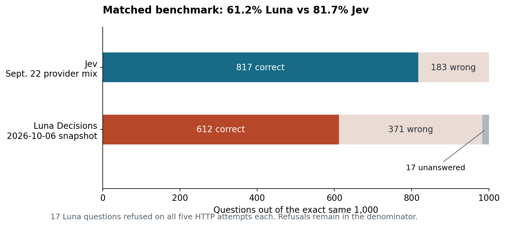
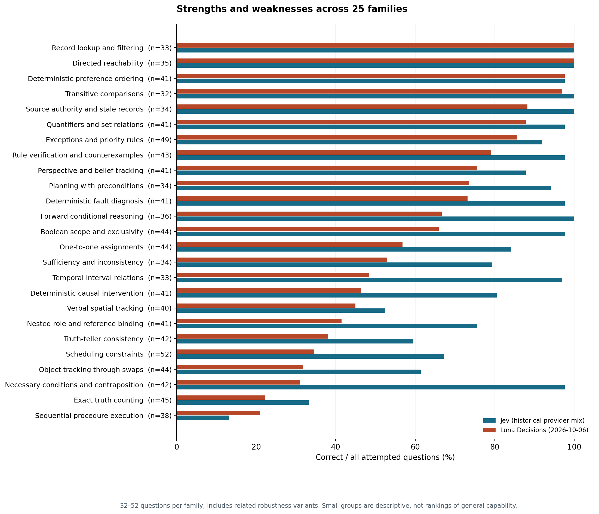
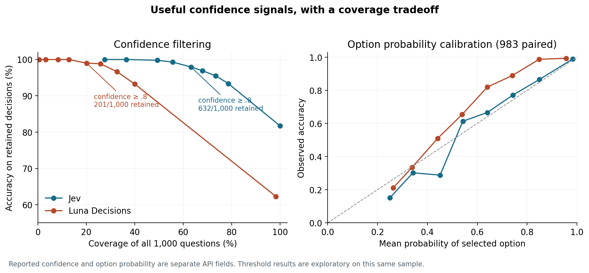

# Luna Decisions vs Jev: the same 1,000 questions

## Expanded reference: 1,136 questions, 14 October 2026

The [expanded report](extension_136/README.md) adds 136 questions to complete candidate checks, option rotations and changed-evidence pairs. Jev 1.13 scores **910/1,136 (80.1%)**; GPT-6 Luna Decisions scores **687/1,136 (60.5%)**, with 23 unanswered items. These totals include dependent diagnostic variants. The original 1,000-question results below remain unchanged.

The new tests strengthen the evidence for Jev's rule-based decisions and clarify its weaknesses: supplying candidate solutions still leaves substantial verification errors, and three complete option-rotation panels change semantic choice. The report includes all 25 reasoning families, confidence coverage, exact model snapshots and dates, [graphics](extension_136/abilities_baseline.png), and a frozen input/response manifest for future releases. No Jev 1.14 results enter this baseline.

An independent comparison of OpenAI's **GPT-6 Luna Decisions** and the recorded **Jev September 22, 2026 provider mix**, using the exact same five-option deterministic logic questions, instructions, facts and option order.

**On this benchmark, Jev scored 817/1,000 (81.7%); Luna scored 612/1,000 (61.2%).** Luna answered 983 questions and left 17 unanswered with API refusal errors. Among answered questions, Luna's accuracy was 62.3%. Its high-confidence decisions were much stronger: **199/201 correct at confidence ≥0.8**, covering 20.1% of the original set.

This evaluates a particular text decision API snapshot on a particular generated logic benchmark. It does not establish a general ranking of either product.



## Exact versions and dates

| Run | Requested model | Model reported by successful responses | Date |
|---|---|---|---|
| Luna, through OpenRouter Decisions | `openai/gpt-6-luna-decisions` | `openai/gpt-6-luna-decisions-20261006` on all 983 successful responses | October 10, 2026 |
| Jev, TypeSafe | `jev-latest` | `jev-1.13.0` on 412 responses | September 22, 2026 |
| Jev, OpenRouter | `jev-latest` | `typesafe/jev-1.13-20260917` on 332 responses | September 22, 2026 |
| Jev, Experiential | `jev-latest` | `jev-latest` on 256 responses; exact underlying snapshot unverified | September 22, 2026 |

The historical baseline is a provider mix, with incomplete snapshot identification for 256 responses. The Luna error responses did not return a model identity. The model alias was captured when the run occurred; future uses of that alias may resolve differently.

## What the comparison shows

| Measure | Jev | Luna Decisions |
|---|---:|---:|
| Attempted questions | 1,000 | 1,000 |
| Valid decisions saved | 1,000 | 983 |
| Correct | 817 | 612 |
| Wrong valid decisions | 183 | 371 |
| Unanswered after primary retry policy | 0 | 17 |
| Correct / all attempted | 81.7% | 61.2% |
| Correct / valid decisions | 81.7% | 62.3% |
| Core-question accuracy | 512/616 (83.1%) | 389/616 (63.1%) |
| Evaluation-split accuracy | 729/900 (81.0%) | 550/900 (61.1%) |

On the **983 mutually answered questions**, both were correct on 573, Jev alone on 231, Luna alone on 39, and both were wrong on 140. Jev's accuracy on that same subset was 81.8%; Luna's was 62.3%. Jev's lead therefore remains when refusals are excluded.

Luna was strongest on directed reachability (35/35), record lookup (33/33), preference ordering (40/41) and transitive comparisons (31/32). Its hardest families included sequential procedures (8/38), exact truth counting (10/45), contraposition (13/42) and object tracking through swaps (14/44). Jev also struggled with sequential procedures and exact truth counting.



## Confidence is useful, but coverage matters

Luna's confidence ≥0.8 subset scored 199/201 (99.0%). At ≥0.9 it scored 128/128. Jev's ≥0.8 subset scored 619/632 (97.9%); its ≥0.9 subset scored 553/557 (99.3%). These are different retained populations. Zero observed errors in a small subset does not guarantee zero future errors.



Confidence is a separate API field from the selected option's probability. Cutoffs here are exploratory descriptions of this sample, not production thresholds validated on a new sample. See the [full analysis](ANALYSIS.md) for all cutoffs, probability scores, difficulty levels and robustness pairs.

## The persistent refusals

OpenRouter returned **HTTP 502** with `OpenAI refused to answer question \"decision\"` for 17 items, without a decision, probability distribution or confidence. Each failed twice in the primary run. A separately retained follow-up made up to three more attempts per refused question: **all 51 additional calls refused**. Each affected question thus refused on five attempts, with no recovery.

The questions are ordinary logic puzzles. The error message does not reveal whether the underlying cause was a safety policy, inability to produce a decision, or an upstream/API issue. Repetition shows persistence in this session, not its cause. All errors and timestamps are retained; see [REFUSALS.md](REFUSALS.md).

## Observed latency and cost

Luna's median successful response time, including the body, was **221 ms** (p95 319 ms). Its comparable response-header median was 221 ms; the historical Jev header median was 338 ms across providers and 262 ms for the 332 OpenRouter responses. Different dates, provider routing, concurrency and network conditions prevent a controlled speed claim. Historical Jev timing also omits the response body and earlier retries/failover; the new run records both boundaries and total item time.

The 983 successful Luna responses reported **$0.0351747** total cost and 351,747 input tokens. The 85 refusal attempts across both runs reported no usage/cost. Their charge is unknown from these responses. Jev's billing fields are incomplete, so this report makes no total-cost winner claim.

## Data and reproduction

- [Questions: all 1,000 exact prompts and options](data/questions_1000.csv)
- [Jev historical results](data/results_jev_1000.csv) and [Luna primary results](data/results_luna_1000.csv)
- [Primary HTTP attempt ledger](data/attempts_luna_1000.jsonl), [refusal follow-up results](data/results_luna_refusal_followup.csv) and [follow-up attempt ledger](data/attempts_luna_refusal_followup.jsonl)
- [Public item metadata](data/item_metadata.csv), [aggregate summary](analysis/summary.json), [family CSV](analysis/family_comparison.csv) and [confidence CSV](analysis/confidence_comparison.csv)
- [Protocol and reproducibility limits](METHODS.md), [refusal details](REFUSALS.md), [checksums](data/checksums.json)

The answer key remains outside this repository, preserving the original benchmark's key separation. Public code and inputs let anyone inspect/replay the requests and verify data integrity. Independently reproducing gold accuracy requires the external key; aggregate scores alone cannot certify that key.

```bash
# Python 3.10+; standard library; no API calls
python3 validate_public.py
python3 -m unittest -v test_benchmark.py test_analysis.py
python3 run_benchmark.py

# Optional figure reproduction
python3 -m pip install -r requirements-plots.txt
python3 plot_results.py
python3 build_report.py

# New paid run: set OPENROUTER_API_KEY in your environment first.
# A fresh output folder keeps the published evidence intact.
python3 run_benchmark.py --execute --run-id my_new_run --out runs/my_new_run
```

The runner uses bounded retries, checkpoints, one retained first valid response per item and no correctness feedback. It never retries a wrong valid answer. It does not automatically re-ask completed refusal rows on resume. See [METHODS.md](METHODS.md) to reproduce scoring with an external key.

## Provenance and API references

The original benchmark is [etsabary/jev-deterministic-benchmark](https://github.com/etsabary/jev-deterministic-benchmark/tree/4dd026a3a530eb9edd41dcdae07d62b7a2446e80). This repository copies its already public questions and response CSV byte for byte. The original bank was `JEV_Deterministic_Decision_Benchmark_v1`; these 1,000 items comprise the 100-question development smoke set and the first 900 items of its shuffled evaluation plan. There was no fresh sampling or Luna-specific prompt tuning.

OpenAI documents its [Decisions API](https://developers.openai.com/api/docs/guides/decisions). This run used [OpenRouter's Decisions endpoint](https://openrouter.ai/docs/api/api-reference/alphadecisions/submit-a-decisions-request) and [GPT-6 Luna Decisions model](https://openrouter.ai/openai/gpt-6-luna-decisions), with the Jev-compatible native choice packet rather than the direct OpenAI endpoint.

Independent community benchmark; no affiliation with OpenAI, OpenRouter or Jev/TypeSafe. Repository code, documentation and benchmark artifacts are shared under the [MIT license](LICENSE).


## Additional check: request rate and refusal patterns

A later test alternated seven refused questions with seven answered controls of the same family and level, using one worker and at least three seconds between request starts. **All seven refused again; all seven controls worked.** This argues against ordinary rate throttling. Refusals include simple unchanged-state questions and occur at all four levels. The model-versus-adapter cause remains unknown; see [the diagnostic evidence and hypotheses](REFUSALS.md#slow-request-rate-control-test-additional-experiment). Primary results remain unchanged.
